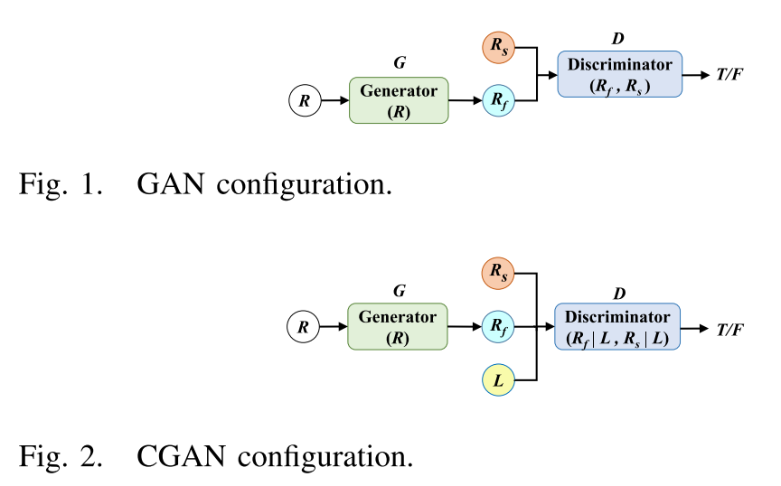
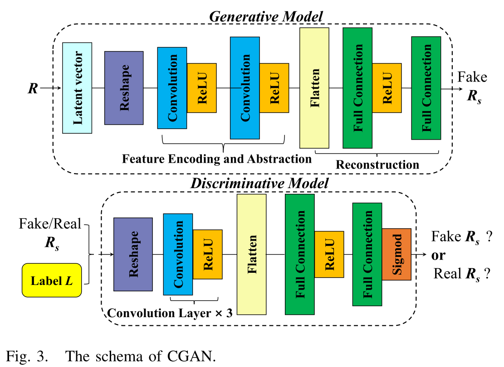
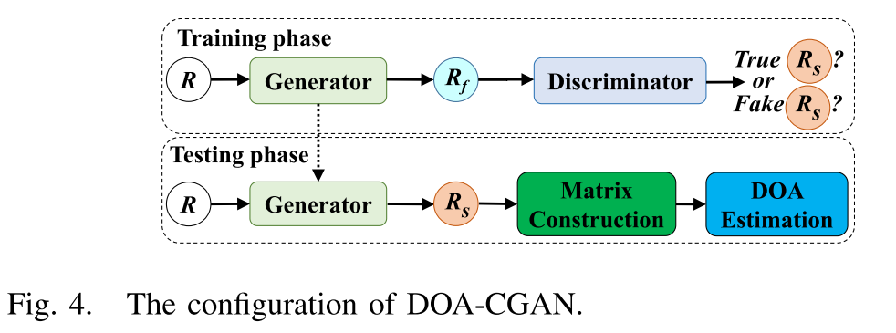
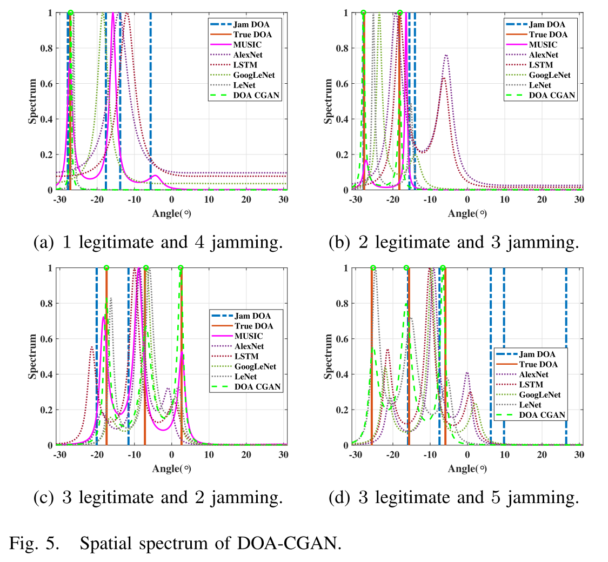

# DOA+ Interference: Evaporation Angle: Method for Generation of Anti-Interference Attacks in DOA Estimation [with code]

Introduction: Interference poses a significant threat to radar systems. From the perspective of interference mechanisms, active jamming can be categorized into two types: suppressive and deceptive [1]. In the absence of interference, radar systems can easily perform direction of arrival (DOA) estimation [2]. However, with the continuous development of interference theory and technology, these advancements pose significant challenges to DOA estimation.
To address this challenge, Minimum Mean Square Error (MMSE), Minimum Variance Uncorrelated Linear Prediction (MVUFL), and Linear Constraint Minimum Variance (LCMV) are prominent adaptive beamforming techniques used to mitigate interference [3], [4]. However, these algorithms typically require preliminary estimates or predefined assumptions about the origin of the desired signal. To our knowledge, there is no existing method for estimating random directional interference signals under DOA conditions.
In this regard, it is necessary to investigate DOA estimation without the need for additional prior information in interference scenarios. Currently, many researchers have developed DOA estimation methods using machine learning technologies [5], [6], [7]. In [6], the author introduces a neural network-based DOA estimation method that uses subarray sampling to estimate the full covariance matrix. In [7], the author uses a Deep Convolutional Network (DCN) to estimate multiple 2D angles by processing discrete subregions in two different stages. Xu et al. proposed a deep neural network (DNN) that learns to transform from received signals to extended correlation matrices, avoiding reliance on specific physical structures [8]. Moreover, many works focus on interference signal recognition and classification [9], [10], [11]. The author presents a new interference recognition network in [9] that can automatically recognize single and convolutional composite interference signals. Additionally, Li Weitao introduced a new method in [10] that utilizes ensemble deep networks combined with transfer learning to accurately identify radar active deceptive interference, even in cases where the training set is limited.
The aforementioned data-driven methods enhance DOA estimation in an undisturbed environment or focus solely on identifying and classifying interference signals. However, these models currently do not consider DOA estimation in interference scenarios. It is noteworthy that their effectiveness against interference signals has not yet been explored, indicating a significant gap in the applicability of these advanced computational methods.
In this letter, inspired by machine learning-based DOA estimation, we propose Direction of Arrival (DOA) estimation through a conditional Generative Adversarial Network (DOA-CGAN), a model specifically designed to enhance robustness against interference. Our model utilizes an unsupervised generator, aiming to create a legitimate correlation matrix (i.e., only including legitimate signals). The main idea is to train the generator to implement filters that can remove interference components from the input signal covariance matrix. After training, we apply the generator as a filter before running classical DOA estimation algorithms. Through numerical simulations, we demonstrate that DOA-CGAN is effective in mitigating DOA estimation affected by interference attacks.
Article illustrations
​

## Images

<!-- PAYMENT_BLOCK -->

## Get this dataset

- Payment link (Stripe): [Buy now](https://buy.stripe.com/3cs8yP7sY87d0vu9AB)
- Payment QR code: 

<!-- /PAYMENT_BLOCK -->
